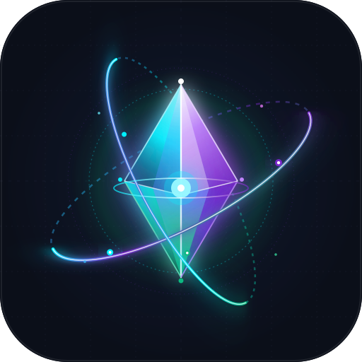

<div align="center">



# Antigravity Unleashed

**Desktop UI modifier (`app.asar`), local OpenAI API bridge, and Web Hub for Google Antigravity IDE.**

[](https://github.com/EinMelih/antigravity-unleashed/stargazers)
[](LICENSE)
[](packages/desktop-ui-modifier/SUPPORTED_UPSTREAM_VERSION)

</div>

---

> **Status: Open-Source Release / Community Handover**  
> I built this setup for my own daily workflow with Google Antigravity (`v2.24.0`), but I'm no longer actively developing it. Between newer models needing less custom scaffolding, Google shipping the headless ACP server (`agy_acp_server.exe`), and tools like T3 Code handling multi-agent worktrees natively, I moved on.  
> Several parts of this repo were vibe-coded and some features are unfinished. Feel free to fork it, fix rough edges, or open Pull Requests.

---

## Overview

This monorepo packages the three components I used to extend the Google Antigravity desktop client on Windows:

```text
antigravity-unleashed/
├── install.bat / install.ps1       # 1-click setup: configures ~/.gemini/config & patches app.asar
├── packages/
│   ├── desktop-ui-modifier/        # Electron v2.24.0 app.asar injector, HUD & auto-rollback repacker
│   ├── web-hub/                    # FastAPI control plane (:8000), OpenAI proxy (:8001) & 36-tool MCP server
│   └── ams-framework/              # Global agent rules, memory compiler (USER/MEMORY) & helper skills
└── tests/                          # Privacy & portability verification suite
```

### 1. Desktop UI Modifier (`packages/desktop-ui-modifier`)

Patches Antigravity's local Electron bundle (`%LOCALAPPDATA%\Programs\Antigravity\resources\app.asar`) to inject custom UI controls directly into the IDE's composer bar:

- **`Unleashed` Quick Menu (`Ctrl+Shift+B`)** — Adds an Orbital Prism **`Unleashed`** button to the bottom composer bar that opens a quick control menu for the Web Hub, API Bridge, Git sync, and patch logs.
- **Live Quota Watcher (`src/ui/quotaWatcher.js`)** — Intercepts `GetUserStatus` / `RetrieveUserQuotaSummary` responses in the renderer to show live 5-hour and weekly quota percentages (`G: 100% | C: 100%`) in the composer bar and falls back to Gemini when Claude quota hits `0%`.
- **Task & Plan Side-Panel (`src/ui/taskTracker.js`)** — Toggleable slide-out panel (`Ctrl+Shift+P`) synced with the active session's `brain/<id>/task.md`, session notes (`notes.txt`), token/cache stats, and GitHub PR/Issue lists.
- **Brain Folder & Conflict Indicator (`src/ui/reviewsDashboard.js`)** — One-click button in the composer bar to open the current conversation's local `brain/` folder in Explorer, pulsing orange when `.conflict` files are detected.
- **API Bridge Monitor (`src/ui/apiMonitor.js`)** — Status indicator for the local OpenAI proxy and isolated `Antigravity-api` profile window.
- **Transactional ASAR Repacker (`scripts/repack_and_restart.py`)** — Verifies upstream SHA-256 hashes (`UPSTREAM_COMPATIBILITY.json`), compiles `src/ui/*.js` into `src/preload.js`, backs up `app.asar` + `app.asar.unpacked`, extracts and repacks via `@electron/asar`, verifies the preload over Chrome DevTools Protocol (CDP), and rolls back automatically if anything fails.

### 2. Web Hub, OpenAI Bridge & MCP Server (`packages/web-hub`)

A local FastAPI + React dashboard and API proxy that drives Antigravity via CDP and SQLite session state:

- **Web Control Plane (`127.0.0.1:8000`)** — Multi-pane ChatDesk, project onboarding, scheduled tasks, and overnight issue-to-PR runner (`nightly_runner.py`).
- **OpenAI-Compatible API Proxy (`127.0.0.1:8001/v1/chat/completions`)** — Lets external tools (Cursor, Continue, Cline, custom scripts) send standard OpenAI SDK requests through an isolated Antigravity Electron profile (`--ams-profile=api`) with SSE streaming and tool-call forwarding.
- **FastMCP Server (`mcp_server.py`)** — Exposes 36 MCP tools for session management, quota inspection, DOM inspection, and headless browser actions.

### 3. AMS Memory Framework & Multi-PC Cloud Sync (`packages/ams-framework`)

- Compiles host-specific `USER.pc.md` and `MEMORY.pc.md` notes into `USER.md` and `MEMORY.md` under `~/.gemini/config/` while enforcing character budgets.
- **Usage Data Persistence (`usage_stats.json`)** — Automatically aggregates token counts, message counts, active chat sessions, skill counts, and per-model usage per device (`hosts.<hostname>`) plus a combined multi-device total (`combined`) inside `~/.gemini/config/usage_stats.json` on every sync.
- **1-Click Private GitHub Backup & Multi-PC Import (`sync_config.py` + UI Modal)** — Open the **`Unleashed`** Quick Menu (`Ctrl+Shift+B` -> **Manuelles Git Sync & Cloud-Backup**) or press `Ctrl+Shift+P` -> **Git Sync**:
  1. **First PC (Setup):** Click **`🔑 1. GitHub Login`** (authenticates `gh` via browser), then click **`🔒 2. Privates Repo erstellen & verbinden`**. This creates a private `antigravity-config` repository on your GitHub account and pushes your memory, skills, and `usage_stats.json` (while `.gitignore` excludes local API keys in `antigravity-hub/config.json`).
  2. **Second PC / Laptop (Import & Restore):** After running `install.bat`, open the Git Sync modal, enter `YourGitHubUser/antigravity-config` (or paste the repo URL), and click **`📥 Auf 2. PC importieren (Pull & Restore)`** (or run `python ~/.gemini/config/scripts/sync_config.py --import-remote YourGitHubUser/antigravity-config`). Any existing local default files are backed up first to `~/.gemini/config/backups/pre-import-<timestamp>/`, the remote history is merged automatically, and `usage_stats.json` combines usage across all synced PCs.
  3. **Optional Background Auto-Sync:** In the `Ctrl+Shift+B` Quick Menu, click **`Auto-Sync (Config)`** to toggle automatic background syncing of `~/.gemini/config` every 15 minutes without touching your coding workspace repositories.

---

## How the `app.asar` Setup Works (Quick Start)

### Prerequisites
- **Windows 10/11** with **Google Antigravity IDE `v2.24.0`** installed in `%LOCALAPPDATA%\Programs\Antigravity`
- **Python 3.11+** and **Node.js 20+** (`node` and `npx` on `PATH`)

### Option A: 1-Click Install (`install.bat`)

Clone the repository and run `install.bat` (or `.\install.ps1` in PowerShell):

```powershell
git clone https://github.com/EinMelih/antigravity-unleashed.git
cd antigravity-unleashed
.\install.bat
```

What `install.bat` does automatically:
1. Installs Python dependencies (`packages/web-hub/requirements.txt` + `aiohttp`).
2. Creates `~/.gemini/config/antigravity-hub/config.json` (if not already present) pointing `hub_root` to `packages/web-hub` and generates a local API key (`sk-ag-...`).
3. Compiles the modular UI scripts (`packages/desktop-ui-modifier/src/ui/*.js`) into `src/preload.js`.
4. Runs `packages/desktop-ui-modifier/scripts/repack_and_restart.py`, which backs up your original `app.asar`, injects the modifier, restarts Antigravity, and verifies via CDP that the **`Unleashed`** button (`Ctrl+Shift+B`) is active.

### Option B: Manual Step-by-Step Setup

If you prefer to run the steps individually or only want either the UI mod or the Web Hub:

**1. Patch `app.asar` (Desktop UI Modifier only):**
```powershell
python packages/desktop-ui-modifier/scripts/build_preload.py
python packages/desktop-ui-modifier/scripts/repack_and_restart.py
```
*(If your Antigravity installation is not `v2.24.0`, the preflight check in `UPSTREAM_COMPATIBILITY.json` will abort safely without touching your `app.asar`.)*

**2. Start the Web Hub (`:8000`) & OpenAI API Bridge (`:8001`):**
```powershell
powershell -NoProfile -ExecutionPolicy Bypass -File packages/web-hub/start_services.ps1
```

**3. Use the Local OpenAI Endpoint (`127.0.0.1:8001/v1`):**
```python
from openai import OpenAI

# Read your generated key from ~/.gemini/config/antigravity-hub/config.json
client = OpenAI(
    base_url="http://127.0.0.1:8001/v1",
    api_key="sk-ag-your-local-token",
)

response = client.chat.completions.create(
    model="gemini-2.5-pro",
    messages=[{"role": "user", "content": "Explain how the ASAR repacker works."}],
)
print(response.choices[0].message.content)
```

---

## Known Limitations & What's Unfinished

If you want to contribute or build on top of this, here is where things stand:

- **Upstream Version Pinning (`v2.24.0`)**: The ASAR injector checks SHA-256 hashes of `dist/main.js`, `dist/ipcHandlers.js`, `dist/preload.js`, `dist/updater.js`, and `dist/utils.js`. When Google ships a new Antigravity version, `SUPPORTED_UPSTREAM_VERSION` and `UPSTREAM_COMPATIBILITY.json` need to be rebased.
- **Renderer Selectors**: Several UI hooks rely on DOM selectors (`button[aria-label="Add context"]`, `[data-testid="settings-button"]`) and CDP script evaluation that can break if upstream changes its React layout.
- **Windows-Specific Process Management**: Process tree discovery, WMI/CIM queries, and PowerShell service launchers (`start_services.ps1`) are built for Windows and haven't been ported to macOS or Linux.
- **Mixed German/English UI Strings**: Because I built this for personal use first, many labels and toast messages in the injected UI (`reviewsDashboard.js`, `modals.js`) are still in German.

Pull Requests, cleanups, and ports to newer Antigravity versions are very welcome — see [CONTRIBUTING.md](CONTRIBUTING.md).

---

## Contact & Maintainer

Created by **[@EinMelih](https://github.com/EinMelih)**.

- If you find the code useful, feel free to leave a ⭐ on the repo.
- For questions, collaborations, or if you want to help maintain the project, open an [Issue](https://github.com/EinMelih/antigravity-unleashed/issues) or reach out via my GitHub profile **[@EinMelih](https://github.com/EinMelih)**.

---

## License & Disclaimer

Released under the [MIT License](LICENSE).  
*Unofficial community project. Not affiliated with, endorsed by, or sponsored by Google LLC.*
