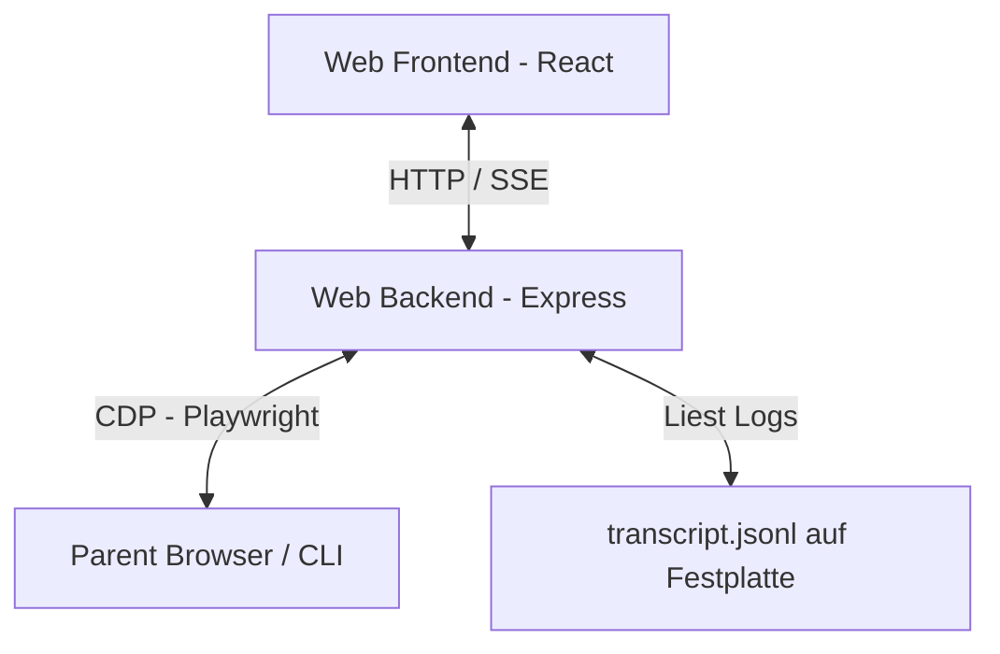

# Antigravity GUI — Benutzerhandbuch & Dokumentation

Willkommen im Benutzerhandbuch für das **Antigravity GUI** Web-Interface! Diese Anwendung ist eine moderne, reaktionsschnelle Web-Oberfläche für die agentischen Programmier-Assistenten von Google DeepMind (Antigravity CLI). Sie ermöglicht es dir, deine Chats, Projekte, Subagenten, Quoten und Dateien übersichtlich an einem Ort zu verwalten.

---

## 📖 Inhaltsverzeichnis
1. [Übersicht & Architektur](#-übersicht--architektur)
2. [Kern-Features](#-kern-features)
   - [Echtzeit-Chat & 1s-Polling](#1-echtzeit-chat--1s-polling)
   - [Live-Denkprozess-Scraper](#2-live-denkprozess-scraper)
   - [Stabile Sortierung in der Seitenleiste](#3-stabile-sortierung-in-der-seitenleiste)
   - [Automatische Subagenten-Gruppierung](#4-automatische-subagenten-gruppierung)
   - [Resiliente Kompaktierungs-Resets](#5-resiliente-kompaktierungs-resets)
   - [Modell-Synchronisation](#6-modell-synchronisation)
   - [Dateibrowser & Editor](#7-dateibrowser--editor)
   - [Quoten & Credit-Limits](#8-quoten--credit-limits)
   - [Smart Scroll & Live-Nachrichtenvorschau](#9-smart-scroll--live-nachrichtenvorschau)
3. [Installation & Betrieb](#-installation--betrieb)

---

## 🏛️ Übersicht & Architektur

Die Antigravity GUI fungiert als Brücke zwischen der originalen Antigravity-Terminal-CLI und einem modernen Web-Interface.



- **Frontend**: React (TypeScript), CSS (Glassmorphismus-Auseinanderbau, dunkles Premium-Design), Lucide-Icons.
- **Backend**: Node.js (Express), SQLite (Lokale Authentifizierung & Einstellungen), Playwright (CDP-Automatisierung).
- **Datenquelle**: Die Web-App greift direkt auf die loggenbasierten Transkripte (`transcript.jsonl`) zu, die von Antigravity im Verzeichnis `~/.gemini/antigravity/brain/` gespeichert werden.

---

## ⚡ Kern-Features

### 1. Echtzeit-Chat & 1s-Polling
Um Eingaben aus der UI und dem Terminal ohne künstliche Verzögerung zu synchronisieren, nutzt das Frontend ein hochfrequentes Polling-Intervall von **1 Sekunde** für:
- Die Aktualisierung der Chat- und Projektliste in der Seitenleiste.
- Das Auslesen des aktiven Nachrichten-Transkripts.
Dadurch erscheinen Antworten und Eingaben fast instinktiv innerhalb von maximal einer Sekunde in der Web-UI.

### 2. Live-Denkprozess-Scraper
Wenn das Modell nachdenkt, wird dieser Vorgang live angezeigt:
- **Technik**: Da die JSONL-Logdatei erst nach Abschluss eines Schritts geschrieben wird, verbindet sich das Backend bei aktiver Generierung per **CDP (Chrome DevTools Protocol)** mit dem Browser-Fenster der CLI.
- **Extraktion**: Mittels eines XPaths (`//button[contains(., "Thought for") or contains(., "Thinking")]/parent::div/following-sibling::div`) wird der fließende Text des Denkprozesses live ausgelesen.
- **UI-Darstellung**: Im Ladebalken (`ThinkingBubble`) wird der Denkprozess in Echtzeit in einer scrollbaren Monospace-Ansicht visualisiert. Über eine Schaltfläche lässt sich dieser Denkprozess jederzeit einklappen, um das Layout sauber zu halten.

### 3. Stabile Sortierung in der Seitenleiste
- **Problem**: Bei paralleler Ausführung von Aufgaben in mehreren Chats sprangen die Chats in der Seitenleiste ständig hin und her, da sie nach dem Änderungsdatum (`lastUpdated` der Logdatei) sortiert waren.
- **Lösung**: Chats und Projekte werden nun stabil nach ihrem **Erstellungszeitpunkt** (`creationTime` der ersten Transkript-Zeile) sortiert. Die Reihenfolge der Chats bleibt während der gesamten Arbeitssitzung fest und übersichtlich.

### 4. Automatische Subagenten-Gruppierung
- **Problem**: Unteragenten (Subagents), die durch das `invoke_subagent`-Tool gestartet werden, sind nicht in den Standard-Projekt-Konfigurationen enthalten und verstopften als "Einzelne Chats" die Seitenleiste.
- **Lösung**: Das Backend durchsucht die Haupt-Logdateien nach `INVOKE_SUBAGENT`-Schritten und extrahiert die Subagenten-IDs und deren zugewiesene Workspaces. 
- **Ergebnis**: Subagenten-Chats werden automatisch in den jeweiligen Projektordner einsortiert und im UI mit einem markanten **SUB**-Badge und einer leichten Einrückung dargestellt.

### 5. Resiliente Kompaktierungs-Resets
- **Problem**: Wenn das Kontextfenster des Agenten zu groß wird, führt die CLI ein "Compacting" durch. Dabei wird die Log-Datei neu geschrieben (Schrittindex wird auf 0 zurückgesetzt). Zuvor kam es hierbei zu Nachrichten-Duplikaten oder Verbindungsabbrüchen.
- **Lösung**: Das Backend erkennt eine Verkleinerung der Dateigröße (`stats.size < filePosition`) im SSE-Stream, setzt den Zeiger zurück und sendet ein `RESET`-Signal. Das Frontend leert daraufhin seinen lokalen State und lädt die neue, kompaktierte Historie sauber von vorne.

### 6. Modell-Synchronisation
Beim Starten der App verbindet sich das Backend per CDP mit der CLI und liest das aktuell vorausgewählte KI-Modell aus. Das Dropdown-Menü in der Web-UI synchronisiert sich automatisch mit dieser Auswahl (z.B. `Gemini 3.5 Flash (High)`).

### 7. Dateibrowser & Editor
- **Dateibrowser**: Navigiere im rechten Tab durch deine Projektdateien oder direkt durch den "Brain Folder" des Agenten (wo Arbeitsdaten und Skripte abgelegt sind).
- **Editor**: Klicke auf eine Datei, um sie im integrierten Code-Editor mit Syntax-Highlighting zu öffnen, zu bearbeiten und direkt zu speichern.

### 8. Quoten & Credit-Limits
In der Seitenleiste siehst du deine aktuellen Google Cloud- / Gemini-API-Limits (Anfragen pro Minute, Token-Limits) und kannst die Option **Credit Overages** (Kostenpflichtige Limit-Überschreitung) per Knopfdruck aktivieren oder deaktivieren.

### 9. Smart Scroll & Live-Nachrichtenvorschau
- **Problem**: Bei langen oder schnellen KI-Ausgaben sprang der Nachrichtenverlauf bei jedem Update automatisch nach unten. Wollte der Benutzer weiter oben etwas nachlesen, wurde er ständig unterbrochen.
- **Lösung**: Das Scrollen wird nun intelligent gesteuert. Wenn der Benutzer hochscrollt (`isAtBottom = false`), wird das automatische Herunterscrollen ausgesetzt.
- **Features**:
  - **Scroll-to-Bottom-Button**: Sobald der Benutzer hochscrollt, erscheint unten rechts ein runder Button mit einem Pfeil nach unten. Ein Klick darauf führt ein weiches Scrollen an das Ende des Chats aus.
  - **Neuer-Inhalt-Indikator**: Wenn neue Nachrichten oder Denkprozesse eintreffen, während der Benutzer hochgescrollt hat, leuchtet auf dem Button ein cyanfarbener Benachrichtigungspunkt auf.
  - **Live-Vorschau-Box**: Links neben dem Scroll-Button erscheint eine Glassmorphismus-Kapsel mit einer Live-Vorschau des aktuellen KI-Ausgabestatus (z. B. `Denkt nach: ...` oder `Schreibt: ...`). Diese Box zeigt in Echtzeit das fließende Textende an. Ein Klick auf die Kapsel scrollt den Benutzer ebenfalls sofort nach unten.

---

## 🚀 Installation & Betrieb

### Voraussetzungen
Stelle sicher, dass Node.js (v18+) und `pnpm` installiert sind und die Antigravity CLI im Hintergrund läuft (sie öffnet üblicherweise einen CDP-Debugging-Port).

### 1. Backend starten
Navigiere in den Backend-Ordner und starte den Server:
```bash
cd backend
pnpm install
pnpm start
```
Der Server läuft standardmäßig auf `http://localhost:58330`.

### 2. Frontend starten
Navigiere in den Frontend-Ordner und starte den Entwicklungsserver:
```bash
cd frontend
pnpm install
pnpm dev
```
Öffne anschließend `http://localhost:5173` im Browser, um das Interface zu nutzen.
