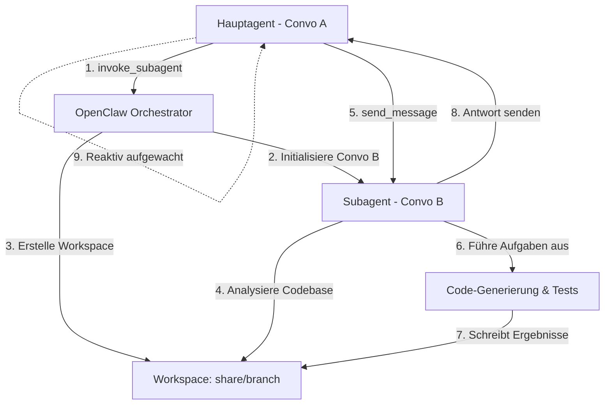

# Antigravity & OpenClaw: Architektur, Updatesicherheit & Subagenten-Flow

Dieses Dokument beschreibt die Strategien zur Absicherung unserer Automatisierung gegen zukünftige Updates der Antigravity-App (v2.01), liefert den Entwurf für eine browserbasierte Benutzeroberfläche (Klon) und erklärt den genauen Ausführungs- und Kommunikationsfluss von OpenClaw und seinen Subagenten.

---

## 1. Updatesicherheit für Antigravity v2.01

Wenn Antigravity ein Update erhält und die Benutzeroberfläche neu gestaltet wird (neue CSS-Klassen, geänderte DOM-Struktur), würden klassische Klick-Automatisierungen fehlschlagen. Um dies zu verhindern, nutzen wir vier Schutzebenen:

### A. Kommunikation über die Dateisystem-Ebene (100% robust)
Antigravity speichert alle Chats, Befehle und Ausgaben live im lokalen Dateisystem:
* **Log-Pfad**: `C:\Users\Yildirim\.gemini\antigravity\brain\<CONVO_ID>\.system_generated\logs\transcript.jsonl`
* **Vorteil**: Diese Datei ist die universelle Datenquelle der Anwendung. Anstatt über die grafische Oberfläche (UI) zu gehen, um Nachrichten zu senden oder zu lesen, können wir direkt Zeilen im JSONL-Format anhängen oder lesen. Diese Struktur ändert sich bei UI-Redesigns nicht.

### B. Abstraktion über den API-Server
Unsere Automatisierungsskripte sprechen nicht direkt mit der UI, sondern nutzen den lokalen `quota_api_server.py` auf Port `58329`.
* Wenn sich Selektoren in der App ändern, müssen wir **nur** die Implementierung im API-Server anpassen.
* Alle externen Tools, Dashboards und OpenClaw-Integrationen bleiben unberührt.

### C. Auslesen der React-Interna (React Fiber)
Anstelle von instabilen CSS-Klassen (z. B. `.bg-muted`, `.z-[2550]`), die durch CSS-Compiler bei jedem Build neu generiert werden, können wir über Javascript auf die React-Interna der DOM-Knoten zugreifen:
* Über Eigenschaften wie `__reactFiber$` oder `__reactContainer$` lässt sich der virtuelle DOM-Baum auslesen.
* Dadurch können React-Komponenten anhand ihrer echten Namen (`SettingsDialog`, `CreditToggle`) gefunden und deren Event-Handler direkt im Speicher aufgerufen werden (`onClick`, `onChange`).

### D. Selektoren-Best-Practices
* **`data-testid` nutzen**: Entwickler verwenden Attribute wie `data-testid="convo-pill-..."` für automatisierte Tests. Diese bleiben über Updates hinweg stabil.
* **Text-Selektoren statt Positions-Selektoren**: `page.locator("span:text-is('Models')")` ist deutlich robuster als ein verschachtelter Pfad wie `div > div:nth-child(2) > span`.

---

## 2. Blueprint: Browserbasierter Antigravity-UI-Klon

Es ist absolut möglich, eine vollständige, edle Kopie der Antigravity-Oberfläche im Webbrowser laufen zu lassen. Da das gesamte System lokal arbeitet, ist der Klon vollständig **API- und dateibasiert**.

```
+-------------------------------------------------------------+
|  [Side Panel]  |  [Header: Running Tasks: 2 Active]         |
|  - Convo 1     |--------------------------------------------|
|  - Convo 2     |  [Chat Window]                             |
|  - Convo 3     |  User: ...                                 |
|                |  Model: ...                                |
|  [Settings]    |                                            |
|  - Quota Bars  |  [Input: ContentEditable Div]              |
+-------------------------------------------------------------+
```

### Technische Architektur

#### 1. Der Backend-Service (Node.js/Express oder Python/FastAPI)
* **Dateisystem-Watcher**: Überwacht den Ordner `C:\Users\Yildirim\.gemini\antigravity\brain` mittels `chokidar` (Node) oder `watchdog` (Python). Sobald eine `transcript.jsonl` beschrieben wird, pusht das Backend die Änderung.
* **Prozess-Überwachung**: Listet aktive Hintergrundprozesse auf und liest die laufenden Subagenten-Tasks aus.
* **API-Endpunkte**:
  * `GET /api/conversations`: Listet alle Chat-Ordner auf.
  * `GET /api/conversations/:id/messages`: Gibt die Nachrichtenhistorie aus der `transcript.jsonl` zurück.
  * `POST /api/conversations/:id/send`: Hängt eine neue Nachricht im JSONL-Format an.
  * `GET /api/tasks/active`: Listet laufende Hintergrundprozesse und deren Fortschritt auf.

#### 2. Das Frontend (Vite + React / Vanilla JS + Premium CSS)
* **Design & Ästhetik**: Dark-Mode mit Glassmorphism-Karten (`backdrop-filter: blur(20px)`), Neon-Glow-Effekten (lila/cyan Verläufe) und modernen Schriftarten (Outfit, Inter).
* **Live-Updates**: Verbindet sich via **WebSockets** oder **Server-Sent Events (SSE)** mit dem Backend, um eingehende Nachrichten und Task-Zustände in Echtzeit anzuzeigen.
* **Task Running View**: Ein Header-Banner oder ein seitliches Panel zeigt alle aktiven Agenten-Tasks. Jedes Mal, wenn ein Subagent arbeitet oder ein Befehl im Terminal ausgeführt wird, blinkt eine Puls-Animation mit dem aktuellen Status und den Live-Logs auf.

---

## 3. OpenClaw & Subagenten-Ausführungsfluss

OpenClaw ist als Multi-Agenten-System konzipiert. Hier ist die genaue Erklärung, wie das Codebase-Verständnis, die workspaces und die Subagenten zusammenspielen:

### A. Codebase-Verständnis & Workspace-Modi
Wenn ein Agent gestartet wird, benötigt er Zugriff auf die Codebasis. OpenClaw unterstützt dafür verschiedene Workspace-Modi:
1. **`inherit` (Standard)**: Der Subagent arbeitet direkt im gleichen Ordner wie der Hauptagent. Änderungen sind sofort für alle sichtbar.
2. **`branch` (Isoliert)**: Erstellt eine vollständige Kopie des Projektordners in einem temporären Verzeichnis. Der Subagent kann dort frei experimentieren und Code ändern, ohne die Hauptdateien zu gefährden. Nach erfolgreicher Arbeit werden die Änderungen zurückgespielt.
3. **`share` (Geteilter Repository-Baum)**: Verhält sich wie ein `git worktree`. Es teilt die Git-Datenbank des Hauptprojekts, erlaubt es dem Subagenten jedoch, auf einem eigenen Branch in einem separaten Arbeitsverzeichnis parallel zu editieren.

### B. Ausführung von Subagenten: Neue Konversation vs. API-Requests
Wenn der Hauptagent das Tool `invoke_subagent` aufruft:
1. **Eigene Konversations-ID**: Es wird **immer eine neue, isolierte Konversation** erstellt. Der Subagent erhält eine eigene Ordnerstruktur unter `brain/` (z. B. `brain/<NEW_CONVO_ID>`).
2. **Warum Isolation?**: Um den Kontext-Fenster-Verbrauch (Tokens) gering zu halten. Wenn der Subagent 10 Dateien analysiert, würde dieser Text das Kontext-Fenster des Hauptagenten verstopfen. Durch die Auslagerung in eine eigene Konversation bleibt der Hauptchat sauber und performant.
3. **Kommunikation**: Hauptagent und Subagent kommunizieren asynchron über das Tool `send_message`. Der Hauptagent sendet eine strukturierte Aufgabe. Der Subagent arbeitet diese ab, schreibt seine Fortschritte in sein eigenes Protokoll und sendet eine Abschlussnachricht zurück.
4. **Kein Polling (Reactive Wakeup)**: Der Hauptagent pausiert, während der Subagent arbeitet. Sobald die Antwort des Subagenten eintrifft, weckt das System den Hauptagenten reaktiv auf.

### Workflow-Diagramm


